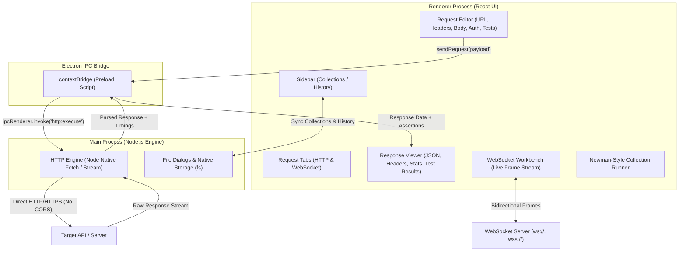

# Project Interceptor: Cross-Platform API Client Roadmap

## 1. Executive Summary & Philosophy
**Interceptor** is a modern, lightweight, privacy-conscious cross-platform desktop API client (macOS, Windows, Linux).
The core principle is **"Start Small, Scale Gracefully"**: begin with an ultra-responsive, zero-clutter HTTP test client that bypasses CORS, then progressively add collections, environment variables, authentication, code generation, test assertions, and multi-protocol capabilities.

---

## 2. Tech Stack

| Layer | Technology | Rationale |
| :--- | :--- | :--- |
| **Desktop Shell** | **Electron** | Direct access to Node.js networking to completely bypass browser CORS restrictions; cross-platform packaging with `electron-builder`. |
| **Frontend Framework** | **React 19 + TypeScript** | Rich ecosystem, fast UI rendering, component reusability. |
| **Bundler & Tooling** | **Vite + @tailwindcss/vite** | Ultra-fast HMR (<150ms builds), modern ES module bundling. |
| **Styling & UI Components** | **Tailwind CSS v4 + Lucide Icons** | Clean developer-tool aesthetics (VS Code / Linear look), accessible primitives, dark theme out of the box. |
| **Persistence** | **Local Storage & File System (JSON)** | Offline-first, fast local storage. File-based collections also allow Git versioning and Postman v2.1 import/export. |

---

## 3. Implementation Milestones

| Milestone | Deliverable | Status |
| :--- | :--- | :--- |
| **Phase 1: Core MVP** | Electron + Vite + React 19 + TypeScript + Tailwind CSS workspace; CORS-free Node HTTP proxy; URL bar with instant cURL paste & auto-import; method selector; Headers/Params/Body editors; deep Response viewer | ✅ Complete |
| **Phase 2: Collections & Migration** | Nested collection hierarchy, folders, Postman v2.1 import/export, collection/folder/request deletion modals, Save flow (`⌘S`) | ✅ Complete |
| **Phase 3: Environments & Variables** | Environment manager, universal variable interpolation across Auth/Body/Headers/Params/Tests, interactive on-hover resolution tooltips, `{{baseUrl}}` variable resolution, dynamic built-in tokens (`{{$guid}}`, `{{$timestamp}}`, `{{$isoTimestamp}}`, `{{$randomInt}}`) | ✅ Complete |
| **Phase 4: Auth & Rich Payloads** | Bearer Token, Basic Auth, API Key helpers; Multipart Form-Data with file uploads, `x-www-form-urlencoded`, raw text, and binary file streaming | ✅ Complete |
| **Phase 5: Code Gen & Testing** | Multi-language Code Generator (cURL, JS Fetch/Axios, Python Requests, Go, Dart); JavaScript test assertions runner; Response saving | ✅ Complete |
| **Phase 6: Multi-Protocol & Runner** | Real-time WebSocket client (`wss://`) with frame composer and live stream; Newman-style batch collection runner with executive scorecards | ✅ Complete |
